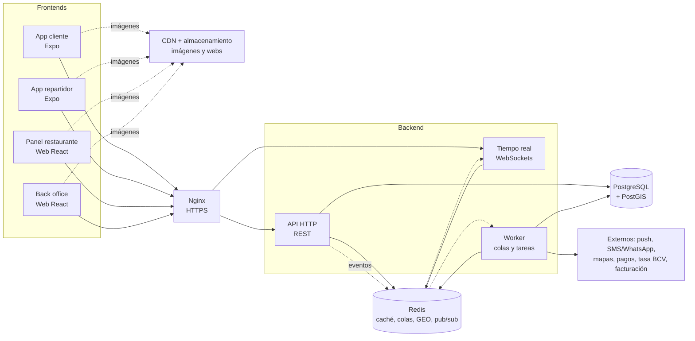

# SionMarket · Propuesta de arquitectura

Versión 1 · 11 oct 2026

## En una frase

Un **monorepo** con 4 frontends (app cliente, app repartidor, panel del restaurante, back office) que solo muestran y capturan datos, y **un backend modular** (Node + TypeScript) que concentra todas las reglas de negocio, corriendo como **3 procesos separados**: API, tiempo real y trabajos en segundo plano. Es el mismo patrón que usan Uber Eats, PedidosYa o Rappi en su etapa temprana: un monolito modular por dominios que luego se parte en servicios cuando el volumen lo pide.

## Por qué monolito modular y no microservicios desde el día 1

- Un solo equipo pequeño: microservicios multiplican despliegues, bases de datos, monitoreo y errores de red sin dar velocidad real a este volumen.
- Las transacciones críticas (crear pedido, cobrar, cambiar estado) quedan en **una sola base de datos**, sin coordinación distribuida.
- Cada módulo tiene fronteras claras (sus tablas, su API interna, sus eventos), así que separarlo después es mover carpetas, no reescribir.
- La velocidad se gana separando **tipos de carga** (HTTP corto, WebSockets largos, trabajos lentos) en procesos distintos, y con caché. Eso sí lo hacemos desde el inicio.

## Mapa general



## Separación de responsabilidades

### Frontends (solo presentación y captura)

| App | Tecnología | Quién la usa | Hace | No hace |
|---|---|---|---|---|
| **App cliente** | Expo / React Native (la actual) | Consumidor | Explorar, carrito, checkout, seguimiento, chat, calificar | Calcular precios finales, validar cobertura, decidir estados |
| **App repartidor** | Expo / React Native (nueva) | Repartidor | En línea/fuera, recibir ofertas, aceptar, retiro con PIN, navegación, entrega, enviar ubicación | Elegir a quién se asigna el pedido |
| **Panel restaurante** | React + Vite (web estática, tablet o PC) | Restaurante | Menú y modificadores, agotados, horario, bandeja de pedidos con alerta, aceptar/rechazar, «Pedido listo» | Cobrar o liquidar |
| **Back office** | React + Vite (web estática) | Equipo SionMarket | Torre de control en vivo, zonas y tarifas, alta de restaurantes y repartidores, cupones, soporte, reportes | — |

Regla de oro: **el servidor es la única fuente de verdad**. El total, la tarifa de delivery, la tasa Bs/USD, si una dirección tiene cobertura y qué estado puede seguir a cuál se calculan en el backend; los frontends muestran lo que el backend responde. Así no hay pedidos con precios manipulados ni apps desactualizadas con reglas viejas.

### Backend: módulos por dominio

Cada módulo es dueño de sus tablas; otro módulo no las toca directamente, le pide al módulo o escucha sus eventos.

| Módulo | Responsabilidad | Requerimiento |
|---|---|---|
| **identidad** | OTP por SMS/WhatsApp, Google/Apple, sesiones (JWT corto + refresh), roles (cliente, repartidor, restaurante, admin) | RF-C01 |
| **usuarios** | Perfil, direcciones con alias y pin, referidos | RF-C01, C02, C09 |
| **cobertura** | Zonas en mapa (PostGIS), validar dirección, lista «avísame cuando lleguen» | RF-C02, back office |
| **catalogo** | Restaurantes, horarios, monto mínimo, menú, categorías, productos, grupos de modificadores con reglas, agotados | RF-C03, C04, panel |
| **busqueda** | Búsqueda por restaurante y plato, filtros y orden (PostgreSQL full‑text + trigram al inicio) | RF-C03 |
| **carrito** | Carrito guardado en servidor para sincronizar entre dispositivos | RF-C04 |
| **precios** | Tarifa de delivery por zona/distancia, propina, cupones, tasa BCV, desglose restaurante vs. SionMarket | RF-C05, C09 |
| **pedidos** | Máquina de los 10 estados, quién puede mover cada transición, bitácora de cambios, cancelaciones | Sec. 5, RF-C06 |
| **pagos** | Pago Móvil y transferencia (verificación/conciliación), tarjeta, efectivo, reembolsos | RF-C05 |
| **asignacion** | Motor de asignación: buscar repartidores cercanos en línea, puntuar, ofertar con tiempo límite, reasignar | 4.4 |
| **flota** | Repartidores, vehículo, estado en línea, ubicación en vivo, PIN de retiro | 4.3 |
| **mensajeria** | Chat cliente‑repartidor (entregado/leído, ubicación, fotos), plantillas rápidas | RF-C07 |
| **notificaciones** | Push (Expo), SMS/WhatsApp de respaldo, alertas sonoras al panel | RF-C06 |
| **postventa** | Calificación doble (comida y entrega), reportes de problema, tickets de soporte | RF-C08 |
| **facturacion** | Factura del delivery (SionMarket); la comida la factura el restaurante; liquidaciones a restaurantes y repartidores | RF-C05, C08 |
| **admin** | Endpoints del back office, auditoría de acciones | 4.5 |

### Procesos del backend (mismo código, 3 puntos de entrada)

| Proceso | Qué atiende | Por qué separado |
|---|---|---|
| **api** | Peticiones REST cortas de las 4 apps | Escala horizontal (2+ copias detrás de Nginx); no se bloquea con trabajo lento |
| **realtime** | WebSockets (Socket.IO): seguimiento del pedido, ubicación del repartidor, chat, bandeja del restaurante, torre de control | Las conexiones largas no consumen los recursos del API; se escala aparte |
| **worker** | Colas (BullMQ sobre Redis): enviar push/SMS, ofertas con vencimiento, reasignaciones, cancelar pedidos sin respuesta, facturas, conciliación, tasa BCV, reportes | Nada lento ocurre dentro de una petición del usuario |

## Decisiones técnicas

| Tema | Elección | Motivo |
|---|---|---|
| Monorepo | pnpm workspaces + Turborepo | Un solo repo, builds incrementales, tipos compartidos |
| Backend | NestJS sobre Fastify, TypeScript | Módulos por dominio nativos, Fastify es de los servidores Node más rápidos |
| ORM / migraciones | Drizzle ORM | Ligero, SQL explícito, buen soporte de PostGIS |
| Base de datos | PostgreSQL 16 + PostGIS | Transacciones fuertes para pedidos y pagos; zonas y distancias geográficas |
| Caché, colas, GEO, pub/sub | Redis 7 | Un solo servicio cubre las 4 necesidades |
| Contratos | Paquete `contracts` con esquemas Zod | Mismos tipos y validaciones en backend y en las 4 apps |
| Cliente HTTP en apps | TanStack Query + cliente tipado generado | Caché local, reintentos, actualizaciones optimistas |
| Imágenes | Almacenamiento S3 compatible (p. ej. Cloudflare R2) + CDN con redimensionado | Fotos de menú rápidas sin pasar por el servidor |
| Webs | React + Vite como sitios estáticos en CDN | Carga inmediata, despliegue trivial |
| Apps móviles | EAS Build, Submit y Update | Tiendas Android/iOS y parches de JS sin pasar por revisión |

## Estructura del monorepo

```
sionmarket/
├─ apps/
│  ├─ cliente/            App Expo del consumidor (la actual se mueve aquí)
│  ├─ repartidor/         App Expo del repartidor
│  ├─ panel-restaurante/  Web React + Vite
│  ├─ backoffice/         Web React + Vite
│  └─ backend/            NestJS: src/modules/<dominio>, main-api.ts, main-realtime.ts, main-worker.ts
├─ packages/
│  ├─ contracts/          Esquemas Zod, tipos, estados del pedido (hoy en src/data/order-states.ts)
│  ├─ api-client/         Cliente tipado + hooks de TanStack Query
│  ├─ ui/                 Tokens de marca (#FB6301, #B30A24, tipografías, ángulo 16°)
│  └─ config/             tsconfig, eslint, prettier
├─ infra/
│  ├─ docker-compose.prod.yml
│  ├─ nginx/
│  └─ scripts/            backups, despliegue
└─ .github/workflows/     CI y CD
```

## Cómo se gana velocidad (lo que el usuario siente)

1. **Home y menús desde caché.** El catálogo cambia poco: se guarda en Redis por zona y se invalida cuando el restaurante edita su menú. El home responde en milisegundos sin consultar la base de datos.
2. **Imágenes por CDN** en tamaños para móvil (y `expo-image` con caché en el teléfono).
3. **Crear pedido es una sola transacción corta.** Todo lo demás (avisar al restaurante, push, factura) se publica como evento y lo hace el worker después. Patrón *outbox*: el evento se guarda en la misma transacción para que nunca se pierda.
4. **Ubicación del repartidor solo en Redis.** Cada 4–5 s el repartidor envía su posición por WebSocket; va a Redis GEO y se reenvía al cliente que sigue ese pedido. A PostgreSQL solo va una muestra para historial. Así la base de datos no se satura.
5. **Asignación en memoria.** El motor busca repartidores cercanos con `GEOSEARCH` de Redis, puntúa (distancia, carga, calificación), oferta con vencimiento de 30 s mediante trabajos con retraso y pasa al siguiente si nadie acepta.
6. **Tiempo real en vez de consultas repetidas.** Las apps no preguntan «¿cambió mi pedido?» cada pocos segundos; el servidor les avisa por WebSocket (y por push si la app está cerrada).
7. **Respuestas compactas y paginadas**, compresión gzip/brotli en Nginx, HTTP/2, y conexiones a PostgreSQL reutilizadas (pool; PgBouncer cuando haya varias copias del API).
8. **Actualizaciones optimistas** en las apps: el botón responde al instante y se corrige si el servidor dice lo contrario.

## Cuándo partir en servicios

Cuando las métricas lo pidan, los primeros candidatos en separarse son, en este orden: **tiempo real + flota** (más conexiones y ubicaciones), **asignación**, **notificaciones** y **búsqueda** (a Meilisearch/OpenSearch). Como cada módulo ya tiene sus tablas y se comunica por eventos, separarlo es darle su propio proceso y su propia base.

## Orden de construcción sugerido

1. Monorepo, `contracts`, backend con identidad, catálogo, cobertura, precios y pedidos; conectar la app cliente al API real.
2. Panel del restaurante (bandeja de pedidos en vivo, menú) y notificaciones.
3. App del repartidor, flota, tiempo real del seguimiento y motor de asignación.
4. Pagos reales, facturación del delivery, back office (torre de control, zonas, tarifas, cupones).
5. Pulido: chat completo, calificación doble, reportes, referidos, métricas.

## Por confirmar

- Dominio definitivo (en los documentos se usa `sionmarket.com` como ejemplo).
- Proveedores en Venezuela: banco o pasarela para Pago Móvil y tarjeta, imprenta digital autorizada por el SENIAT para la factura del delivery, y proveedor de SMS/WhatsApp.
- Mapas: Google Maps Platform (mejor cobertura de direcciones en San Felipe) o Mapbox (más barato).
